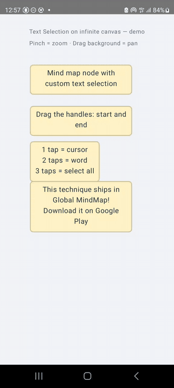
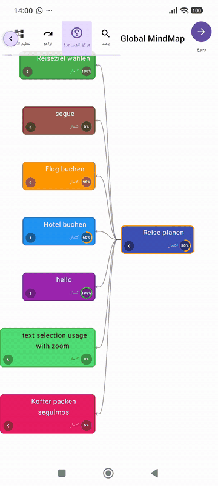

# Custom Text Selection on an Infinite Canvas (Jetpack Compose)

Compose gives you a `BasicTextField`, but the moment your text lives inside a pannable/zoomable canvas (mind maps, whiteboards, image annotation), the native text selection falls apart: the system toolbar invades, the handles fight your gestures, and editing a custom selection silently loses text.

This repo is a minimal, working demo of a technique that solves all of it — battle-tested in production by [Global MindMap](https://play.google.com/store/apps/details?id=com.global.mind.map) (a mind map app with 150+ languages, RTL included).



## Used in production — Global MindMap

This exact technique ships in [Global MindMap](https://play.google.com/store/apps/details?id=com.global.mind.map), a free mind map app with **150+ UI languages**. Real-world usage, editing a node **with the entire app UI in Arabic (RTL)** — mirrored toolbar, mirrored handles, magnifier working:



*(Real app, no mockups.)*

## What the demo does

- Tap the background: pan / pinch to zoom the canvas
- Tap a card to edit it (everything gets selected, like a mind map node)
- 1 tap = place cursor · 2 taps = select word · 3 taps = select all
- Drag either cyan handle — start or end — with a fixed anchor on the opposite end (RTL-safe)
- Magnifier loupe while dragging (a `Popup`, unaffected by canvas zoom)
- Type or press Backspace with an active custom selection: it replaces/deletes the selected range correctly

## The 6 pillars of the technique

### 1. Kill the native toolbar
Provide an empty `LocalTextToolbar` (`status = Hidden`, `showMenu` empty). This stops the Samsung/One UI (and stock) cut/copy/popup from ever appearing over your canvas.

### 2. Make the native handles invisible
`TextSelectionColors(handleColor = Transparent, backgroundColor = translucentBlue)` via `LocalTextSelectionColors`. The system stops drawing its own handles (which lag/bug inside transformed canvases) — you draw **your own** droplet handles on top.

### 3. Draw the selection highlight yourself
In a `Canvas` overlay, paint `layout.getPathForRange(sel.min, sel.max)`. Pixel-perfect, independent of the system, works at any zoom.

### 4. Multi-tap counting with event consumption (the secret sauce)
Count taps in a ~400 ms window in an `awaitEachGesture`. From the **second** tap on, **consume the down event** (`PointerEventPass.Initial`) and keep consuming until release — otherwise `BasicTextField` clears your selection on the finger-up. 1 tap = cursor, 2 = word (`getWordBoundary`), 3 = select all.

### 5. Honest hit-boxes
Reserve real vertical space below the text while editing (so the handles below the last line stay inside the touchable area), and measure the editing bar height instead of hardcoding offsets.

### 6. Editing while a custom selection is active (the part everyone gets wrong)
The internal `BasicTextField` selection stays **collapsed at the END of your custom selection** (`TextRange(sel.max)`, plus `composition = null` on every state write). Consequences:

- The IME's Backspace still fires `onValueChange` (cursor is ≥ 1 char inside the range), so deletion works
- When the IME reports a text change, compute what was actually inserted via a prefix/suffix diff (`replaceCustomSelectionOnEdit`) and splice it over the selected range
- Hardware Backspace/Delete is intercepted in `onPreviewKeyEvent` and removes the range directly
- A native (long-press) selection produced by the system is converted into your custom selection on the spot

### Bonus: zoom-aware gesture slops
Inside a scaled canvas, fixed pixel slops break: at low zoom the node shrinks and your 40 dp slop swallows double/triple taps. Divide tap slop and drag slop by the current canvas scale (floor ~0.4), and clamp the multi-tap timeout to ≥ 420 ms.

### Bonus: handle touch targets
Handles get a 48 dp invisible touch target placed with a 0×0 outer layout (so it doesn't inflate the field) and a frozen visual center while dragging (no feedback loops while the selection changes).

## Using it in your app

Give your agent of choice the file [`SelectionCard.kt`](app/src/main/java/com/example/textselectioncanvas/SelectionCard.kt) (self-contained: card, gestures, handles, loupe) plus the 6 pillars above, and ask it to adapt the card into your canvas item. The pieces are generic — nothing here is mind-map specific.

Tested with: Gradle 9.7.0 · AGP 9.3.2 · Kotlin 2.3.0 · Compose BOM 2025.10.01 · minSdk 27 · targetSdk 36.

## Run

```bash
./gradlew assembleDebug
```

Open in Android Studio and run on any device (API 27+).

---

*This selection technique is implemented in production in [Global MindMap](https://play.google.com/store/apps/details?id=com.global.mind.map) — download it on Google Play.*
